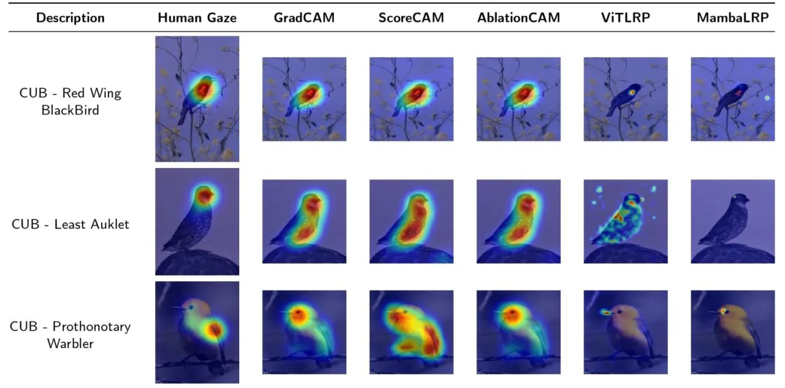

# 👋 Hi, I'm Francesco

Computer Engineering student at the University of Padova, working on **Computer Vision and AI for robotics**: building systems that perceive and act in the real world.  
📫 [LinkedIn](https://www.linkedin.com/in/francesco-roncolato) · 📄 CV: [🇬🇧 English](https://github.com/roncooo/roncooo/blob/main/cv/FrancescoRoncolato_CV_en.pdf) · [🇮🇹 Italiano](https://github.com/roncooo/roncooo/blob/main/cv/FrancescoRoncolato_CV_it.pdf)  
🔎 Open to internships in robotics perception and intelligent systems.

---

## 🎓 Master's Thesis (in progress)

**Active View Selection for Articulated Objects**  
Choosing where a robot's camera should look next. With only about 20 views, the goal is to reconstruct an object with moving parts (a laptop lid, a microwave door) well enough to recover its joints, and to do it fast enough to run on a real robot.  
- Built the full pipeline. Articulated objects from PartNet-Mobility are rendered as RGB-D with BlenderProc, reconstructed with 3D Gaussian Splatting and Deformable 3DGS, and the next view is chosen from the model's Fisher information (FisherRF).
- Designed a causal active loop. The object moves on its own while the camera decides where to look next, and one deformable model keeps training from a depth-initialized start instead of being retrained from scratch after every pick.
- Compared information-based selection against fair baselines: uniform random and farthest pose. FisherRF's built-in random baseline turned out to be biased, and the simple farthest-pose rule is a strong competitor when there are very few views.

`PyTorch` `3D Gaussian Splatting` `Active Perception` `BlenderProc` `PartNet-Mobility`

---

## 📄 Publications

**Bridging Human and Model Attention: Explainability Analysis of CNN, Mamba, and ViT Architectures with Gaze-Based Validation**  
M. Stefani, E. Parpaiola, M. Bino, G. Caregnato, **F. Roncolato**, D. Fusaro, L. Nanni, A. Pretto  
*Preprint, under journal review* · [arXiv:2610.12703](https://arxiv.org/abs/2610.12703) · [Code](https://github.com/CaregnatoGianluca/VisionExplainability)  
Compares how CNNs, Vision Transformers and Vision Mamba models explain their decisions by measuring how well their saliency maps match human eye-tracking data. Tested on fine-grained bird classification (CUB-200-2011) and chest X-rays (MIMIC-CXR), using GradCAM, ScoreCAM, AblationCAM, ViT-LRP and MambaLRP.  
`PyTorch` `XAI` `Vision Mamba` `ViT` `Eye-Tracking`

---

## 🚀 Featured Projects

### 👁️ [Predicting Human Gaze: CNNs vs Vision Transformers](https://github.com/Roncooo/NNDL_Vision-Based-Saliency-Prediction)
A modular PyTorch framework for visual saliency prediction that compares a VGG-16 encoder with a Swin Transformer under the same multi-scale decoder, and tests a combined KL + correlation loss against plain MSE.  
**Result:** Swin-T with the combined loss reached **CC 0.90** on the SALICON validation set and on the official held-out test server, beating the VGG-16 baseline (0.88). It also generalized across datasets to MIT1003.  
`PyTorch` `Swin Transformer` `VGG-16` · [📄 Report](https://drive.google.com/file/d/1gpnjfCShSAhM8uc7DkinZNquXevbn9kK/view?usp=drive_link)

### 📦 Pallet Box Counting
A classical computer vision pipeline (no deep learning) that finds a pallet in a single smartphone photo and counts the boxes on each visible face. The known box dimensions, projected through the pinhole camera model, are used to throw out false edges caused by tape, labels and printed logos.  
**Result:** Pallet segmentation reached **0.90 mIoU**. On 20 real photos with distractor boxes and tape, the mean count error was **about 1 box per face**, and 30 of 40 side faces were counted exactly. Runs on CPU only, with the line-selection model solving in about 1 s.  
`OpenCV` `Python` `Pinhole Model` `Hough Transform` `Homography`

### 🧮 Smart Canteen Scheduling
Plans university canteen menus to balance user satisfaction against food waste, under nutritional, vegan-option and ingredient-spoilage constraints. The exact MILP model is paired with fast heuristics: greedy, CSP and Tabu Search.  
**Result:** On the largest instance (40 dishes, 10 days, 300 users), Gurobi needed about 22 minutes to reach the optimum. CSP + Tabu Search came within **about 6% of optimal in under 5 minutes**, and the CSP alone found a feasible schedule in 0.3 s.  
`Python` `Gurobi` `OR-Tools CP-SAT` `Tabu Search`

### 🃏 [Primi Composti: Game-Playing AI](https://github.com/Roncooo/gtproject)
Game-theory analysis of a two-player arithmetic card game. The full game tree has about 2.3·10¹⁷ nodes, so the project uses depth-limited minimax agents (depths 2 to 6), alpha-beta pruning to solve the 6-card endgame exactly, and a play-against-the-computer mode.  
**Result:** Over 1,000 simulated games per pairing, depth-4/5 minimax beat greedy strategies **81–90%** of the time. Simulations ran in parallel across 16 cores.  
`Python` `Minimax` `Alpha-Beta Pruning` `Game Theory` · [📄 Report](https://github.com/Roncooo/gtproject/blob/main/Primi_Composti.pdf)

### 📱 [WhatsaPD](https://github.com/Roncooo/WhatsaPD)
Accessible city guide for Padua, built to Android's inclusive-design guidelines. It works fully with TalkBack, Switch Access and Voice Access, and includes landmark info, user reviews, favourites and a "near me" view. [Download the APK](https://github.com/Roncooo/WhatsaPD/raw/develop-accessible/app/release/WhatsaPD-v1.0-release.apk)  
`Kotlin` `Android` `Room` `MVVM` `Accessibility`

---

## 🌱 Currently Working On
- **Active view selection for articulated objects** (thesis)
- **Explainable AI**

---

## 🛠️ Tech
<table>
  <tr>
    <td><b>Languages</b></td>
    <td></td>
  </tr>
  <tr>
    <td><b>CV & ML</b></td>
    <td> Vision Transformers · 3D Gaussian Splatting</td>
  </tr>
  <tr>
    <td><b>Robotics</b></td>
    <td> Robot simulation · BlenderProc</td>
  </tr>
  <tr>
    <td><b>Tools</b></td>
    <td></td>
  </tr>
</table>
